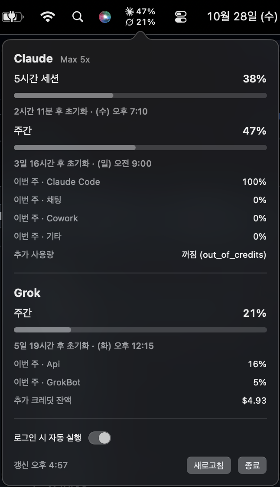

# atus

A macOS menu bar app that shows how much of your AI subscription limits you have used: **Claude**, **Codex (ChatGPT)**, **Grok**, **Cursor**, and **GitHub Copilot**. Pick the ones you use.

Each tracked service gets a logo and a percentage in the menu bar. Click it for the details: every limit window, per-product breakdowns, extra-usage credits, and a countdown to each reset.

<p align="center">
  
</p>

> The UI is currently in Korean.

## What it shows

| Service | Sign-in atus uses | Shown |
|---|---|---|
| Claude (Pro / Max) | Claude Code | 5-hour session %, weekly %, per-model weekly % (if your plan has them), weekly usage by product, extra-usage spend |
| Codex (ChatGPT Free / Plus / Pro) | Codex CLI | every limit window the CLI reports (for example 5-hour and weekly, or 30 days on Free), credits, plan |
| Grok (SuperGrok / X Premium) | Grok CLI | weekly pool %, usage by product, extra-usage credit balance, plan name (product split and plan name depend on which Grok source answered; see [How it works](#how-it-works)) |
| Cursor | Cursor app | billing-cycle usage %, Auto / API split, included usage in dollars, on-demand spend, plan |
| GitHub Copilot | GitHub CLI (`gh`) | premium requests, chat, and completions quotas that your plan meters, with remaining counts and monthly reset |

## Choosing services

On first launch atus turns on every service whose app or CLI it finds set up on your Mac. Upgrades from 0.1.x keep Claude and Grok. To change the selection, open the panel and expand **서비스 선택** (choose services), then tick the ones you want. At least one stays on. Services atus doesn't support yet can be added as [plugins](#plugins-any-other-service).

The menu bar shows the tracked services two rows per column. More services make the label wider, which matters on a MacBook with a notch. On first launch atus places itself at the right end of the menu bar items. After that it stays wherever you ⌘-drag it, or wherever Ice or Bartender puts it.

Each number is the window closest to its limit, since that is the one that stops you first. A `!` after a number means the last refresh failed and the value shown is the last good one. Open the panel to see why.

## Plugins: any other service

Any service can be added with a small script: atus runs it and reads usage from the JSON it prints. A plugin then appears in the menu bar, the panel, and **서비스 선택** like a built-in service. Since the script, not atus, decides how to authenticate, you stay in control of credentials and of each vendor's terms.

1. Write a script that prints:
   ```json
   {
     "plan": "Pro",
     "windows": [
       { "label": "5h", "percent": 42, "resetsAt": "2026-10-28T12:00:00Z" },
       { "label": "week", "percent": 18 }
     ],
     "details": [{ "label": "Credits", "value": "$12.00" }]
   }
   ```
   - `windows` are the limits. `percent` is how much is used (0–100), and the menu bar shows the highest one.
   - `resetsAt` is optional and may be ISO-8601 or Unix seconds.
   - `plan` and `details` are optional extra lines in the panel.
   - On failure, print a short reason to stderr and exit non-zero. The panel shows the last stderr line.

   [`examples/plugins/demo.sh`](examples/plugins/demo.sh) is a starting point.
2. Register it in `~/.config/atus/providers.json`. **서비스 선택 → 플러그인 설정 열기** creates and opens the file.
   ```json
   {
     "providers": [
       { "id": "demo", "name": "Demo", "command": "~/atus-plugins/demo.sh", "icon": "sparkles" }
     ]
   }
   ```
   | Field | |
   |---|---|
   | `id` | Unique, and not one of the built-in IDs (`claude`, `codex`, `grok`, `cursor`, `copilot`). |
   | `name` | Shown in the panel. |
   | `command` | Run with `/bin/sh -c` from your home directory, with `~/.local/bin`, `/opt/homebrew/bin` and `/usr/local/bin` on `PATH`. |
   | `icon` | Optional. An [SF Symbol](https://developer.apple.com/sf-symbols/) name, or the path to an SVG or PNG (drawn monochrome). The default is a puzzle piece. |
   | `requirement` | Optional caption under the name in **서비스 선택**. |
   | `timeout` | Optional, in seconds. The default is 30. |

atus re-reads the file on every refresh (⌘R in the panel). New plugins start enabled. Mistakes in the file are listed under **서비스 선택**, and the valid entries still load.

### Why Google Gemini is not built in

Google's [Gemini CLI FAQ](https://geminicli.com/docs/resources/faq/) forbids third-party tools from reusing Gemini CLI or Antigravity OAuth credentials to reach Google's backend. It names account suspension as a consequence, and suspensions have been reported, including for paid accounts. That rules out the token reuse other usage trackers rely on, so atus doesn't ship it. If you still want Gemini in your menu bar, a plugin lets you decide how to get the numbers and take that call yourself.

## Requirements

- macOS 14 or later (Apple silicon or Intel)
- Signed in to the tool for each service you track:
  - Claude: [Claude Code](https://code.claude.com) with a Pro or Max plan (`claude`, then `/login`)
  - Codex: the [Codex CLI](https://github.com/openai/codex) signed in with ChatGPT (`codex login`)
  - Grok: the [Grok CLI](https://x.ai/cli) (`grok login`)
  - Cursor: the [Cursor](https://cursor.com) app
  - GitHub Copilot: the [GitHub CLI](https://cli.github.com) (`gh auth login`) on an account with Copilot

## Install

1. Download **[Atus.dmg](https://github.com/Bill1907/atus/releases/latest/download/Atus.dmg)** from the latest release.
2. Open it and drag **Atus** into **Applications**.
3. Open Atus from Applications. It lives in the **menu bar**; there is no Dock icon.
4. Optional: in the panel, turn on **로그인 시 자동 실행** (launch at login).

Releases are signed with a Developer ID and notarized by Apple, so the app opens without Gatekeeper warnings.

### Update

atus does not update itself. Download the latest `Atus.dmg` and replace the app in Applications. Your settings and menu bar position are kept.

### Uninstall

1. In the panel, turn off **로그인 시 자동 실행** if you turned it on, then click **종료** (quit).
2. Delete `/Applications/Atus.app`.
3. Optional: remove its preferences with `defaults delete com.boseongkim.atus`, and `~/.config/atus` if you added plugins.

atus stores nothing else. It never writes to any service's login files.

### Build from source

Requires Xcode 26 or later (CI builds with Xcode 26.6).

```sh
git clone https://github.com/Bill1907/atus.git
cd atus
./scripts/bundle.sh --install   # builds, copies to /Applications, launches
```

## How it works

atus refreshes the tracked services every 5 minutes, after the Mac wakes, when you open the panel (if the data is more than a minute old), and on ⌘R while the panel is open.

- **Claude** reads the OAuth token Claude Code keeps in the login keychain (`Claude Code-credentials`) through `/usr/bin/security`, then calls `GET https://api.anthropic.com/api/oauth/usage`, the endpoint behind Claude Code's `/usage`.
- **Codex** starts `codex app-server` and asks it for `account/rateLimits/read`, the same data the Codex CLI shows. The CLI uses and refreshes its own `~/.codex/auth.json`.
- **Grok** reads the token in `~/.grok/auth.json` and calls `GET https://cli-chat-proxy.grok.com/v1/billing?format=credits`, the endpoint behind Grok CLI's `/usage`. This response includes the per-product split but not the plan name. The token lasts about six hours. Once it expires, atus asks `grok agent stdio` for `_x.ai/billing` instead, and the Grok CLI handles its own login. That response includes the plan name but no per-product split.
- **Cursor** reads the session Cursor.app stores in `~/Library/Application Support/Cursor/User/globalStorage/state.vscdb` (opened read-only) and calls `GET https://cursor.com/api/usage-summary`, the data behind cursor.com's usage dashboard.
- **GitHub Copilot** takes a GitHub token from `gh auth token`, falling back to the Copilot editor plugins' `~/.config/github-copilot` files. It then calls `GET https://api.github.com/copilot_internal/user`, the endpoint Copilot's editor extensions use.

Privacy and safety:

- atus only reads tokens. It never refreshes, rewrites, or copies them anywhere. Where a vendor CLI is started (`codex app-server`, `grok agent stdio`), that CLI manages its own login as it normally would.
- Requests go straight from your Mac to each vendor. There is no atus server and no telemetry.
- These endpoints are undocumented internal APIs and can change without notice. If one breaks, the app keeps the last value and shows the error.

## Troubleshooting

The panel shows the error under the provider's name; the menu bar adds `!` to that number.

| Panel message | Fix |
|---|---|
| Claude `토큰 만료: Claude Code를 한 번 실행하면 갱신돼요` (token expired) | Run `claude` once; Claude Code refreshes its token. |
| Claude `로그인 정보 없음: Claude Code에 로그인하세요` (no login) | Install Claude Code and log in with `/login`. |
| Grok `로그인 정보 없음: grok login을 실행하세요` (no login) | Run `grok login`. |
| Grok `로그인 정보 없음: grok CLI를 찾을 수 없어요` (CLI not found) | The token has expired and atus can't find the Grok CLI. Install it; atus looks in `~/.grok/bin`, `~/.local/bin`, `/opt/homebrew/bin`, `/usr/local/bin`. |
| Codex `로그인 정보 없음: codex CLI를 찾을 수 없어요` (CLI not found) | Install the Codex CLI. atus looks in `~/.local/bin`, `/opt/homebrew/bin`, `/usr/local/bin`. |
| Codex `account/rateLimits/read: …` | Run `codex login`. |
| Cursor `토큰 만료: Cursor 앱을 한 번 열면 갱신돼요` (token expired) | Open Cursor once so it renews its session. |
| Cursor `로그인 정보 없음: Cursor 앱에 로그인하세요` (no login) | Sign in to the Cursor app. |
| Copilot `로그인 정보 없음: gh auth login을 실행하세요` / `토큰 만료: …` | Run `gh auth login` with an account that has Copilot. |
| `HTTP 4xx/5xx` or `응답 해석 실패` (could not parse response) | The vendor endpoint changed or is down. Please [open an issue](https://github.com/Bill1907/atus/issues). |

atus is in the menu bar but you can't see it? On a MacBook with a notch, macOS hides the leftmost items when the menu bar is full. ⌘-drag atus further right, or move it to the visible section in Ice or Bartender.

## Development

```sh
swift test                      # parsing tests
swift run Atus                  # run without bundling
./scripts/bundle.sh --open      # build build/Atus.app and launch it
swift scripts/make-icon.swift   # regenerate Resources/AppIcon.icns
```

Layout:

- `Sources/AtusCore`: providers and response parsing; no UI code
- `Sources/Atus`: AppKit status item with a SwiftUI panel (`main.swift`, `StatusItemController.swift`, `UsagePanel.swift`)
- `scripts/`: bundling, icon, DMG, and release scripts

### Adding a service

Built-in services live in `Sources/AtusCore`. For a personal or experimental one, a [plugin](#plugins-any-other-service) is usually enough.

1. Add a `ProviderID` constant in `Sources/AtusCore/Models.swift`.
2. Implement `UsageProvider` in a new `Sources/AtusCore/<Name>Provider.swift`. `info` holds the display name, requirement caption, and `.bundled` icon. `isDetected` is a cheap local file check, and `fetch()` returns a `UsageSnapshot`. Read the vendor's own login and never write it back. Keep response mapping in a `static func snapshot(from:fetchedAt:)` so it can be unit-tested.
3. Register it in `Providers.builtIn`.
4. Add a monochrome SVG logo to `Sources/Atus/ProviderLogo.swift` and credit its source in `THIRD_PARTY_NOTICES.md`.
5. Add a mapping test with a sanitized real response to `Tests/AtusCoreTests`.

## Releasing

One-time setup on the maintainer's Mac:

1. A **Developer ID Application** certificate and its private key, exported as a `.p12`. Only the team's Account Holder can create the certificate.
2. An **App Store Connect API key** (`.p8`) for notarization: App Store Connect → Users and Access → Integrations → Team Keys.
3. `cp release.env.example release.env` and point it at those files. `release.env` is git-ignored.
4. Log in to the `gh` CLI with push access to this repo.

Then, from a clean `main`:

```sh
./scripts/release.sh 0.1.0
```

This runs the tests and imports the `.p12` into a throwaway keychain, so the login keychain is never touched. It then builds a universal app, signs it with the hardened runtime, and notarizes and staples both the app and `Atus.dmg`. Finally it tags `v0.1.0` and uploads the DMG to a GitHub release. The README download link always points at the latest release.

## License

[MIT](LICENSE)

Claude, Codex, Grok, Cursor and GitHub Copilot are trademarks of Anthropic, OpenAI, xAI, Anysphere and GitHub. Their logos are used only to label each service's numbers. Logo artwork comes from [Simple Icons](https://simpleicons.org) (CC0) and [LobeHub Icons](https://github.com/lobehub/lobe-icons) (MIT); see [THIRD_PARTY_NOTICES.md](THIRD_PARTY_NOTICES.md). atus is not affiliated with any of these companies.
